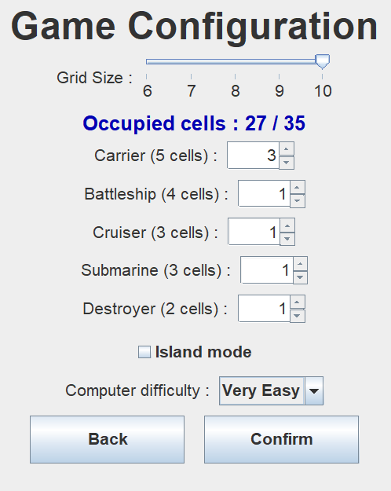
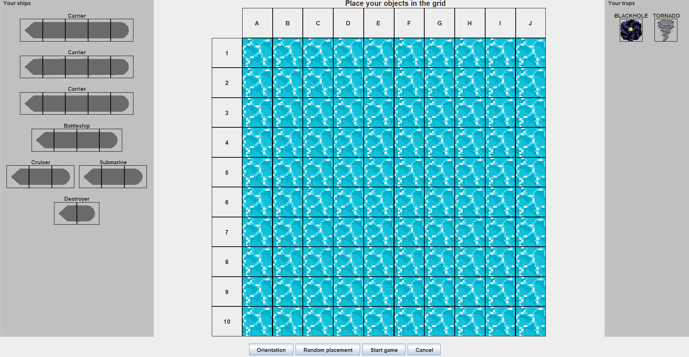
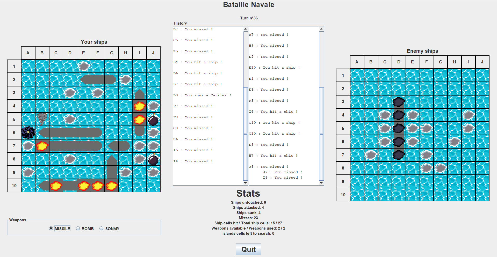

# Bataille navale

Ce projet consiste à développer un jeu de **Bataille navale en Java**, en utilisant la bibliothèque graphique **Java Swing** pour créer l'interface utilisateur.

Le but du jeu est de couler l'ensemble des navires de l'adversaire en tirant sur les cases de sa grille. Le joueur doit faire preuve de stratégie pour localiser et détruire les navires ennemis.

## Configuration

Il est possible de configurer la partie à l'aide de plusieurs paramètres :

- La taille de la grille.
- Le nombre de navires de chaque type.
- L'activation du mode île (détaillé plus bas).
- Le niveau de difficulté de l'ordinateur.

## Placement

Le joueur peut ensuite passer à la phase de placement de ses navires et de ses pièges.

Le placement peut se faire par *glisser-déposer* (*drag and drop*) ou de manière aléatoire.

## Déroulement de la partie

Une fois le placement terminé, la bataille navale peut commencer.

À tour de rôle, le joueur et l'ordinateur s'attaquent jusqu'à ce que l'un des deux ait coulé tous les navires adverses.

## Règles spécifiques

Cette implémentation propose plusieurs règles particulières.

### Armes supplémentaires

- **Bombe :** elle touche la case ciblée ainsi que ses quatre voisines directes : à droite, à gauche, au-dessus et en dessous.
- **Sonar :** il permet de connaître le nombre de cases occupées par des navires parmi la case ciblée et ses huit voisines.

### Pièges

- **Trou noir :** il se place comme un navire. Lorsqu'un joueur le touche, l'attaque est redirigée vers sa propre grille, aux mêmes coordonnées.
- **Tornade :** elle se place comme un navire. Lorsque l'adversaire la touche, les coordonnées de ses trois prochaines attaques sont modifiées.

### Mode alternatif : l'île

L'île est une zone de la grille de taille 4 × 4 dans laquelle sont cachées les armes spéciales décrites précédemment.

Chaque joueur peut ainsi choisir entre attaquer les navires adverses en mer ou fouiller l'île de son adversaire afin d'y trouver des armes spéciales.